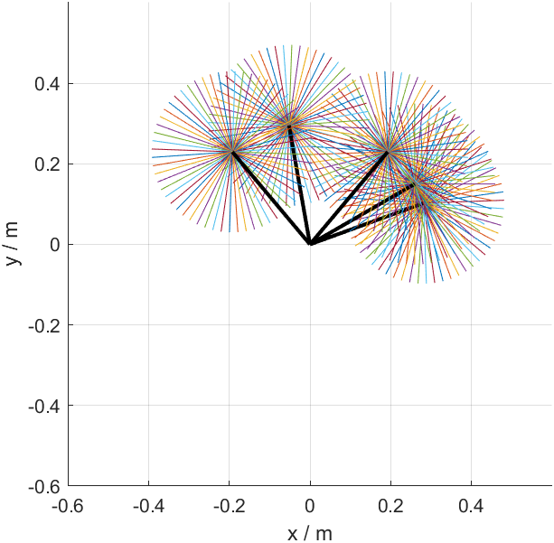

# Robotics Learning Lab

围绕机器人机构学与控制课程开展的 MATLAB 学习与数值实验。当前完成了课程 P1–P5，以及平面两连杆机构的正运动学和离散姿态可视化练习。

## 练习 01：平面开链两连杆

程序：[Simple_OpenChain_TwoLink.m](Simple_OpenChain_TwoLink.m)



### 模型与输入

- 两根刚性连杆在平面内运动，通过两个转动关节连接，基座固定。
- 连杆长度：`L1 = 0.3 m`，`L2 = 0.2 m`。
- `q1` 是第一根杆相对水平正方向的角度；取 `20°、30°、50°、100°、130°` 五个值。
- `q2` 是第二根杆相对第一根杆延长方向的转角；在 `[-π, π]` 内取 61 个采样值。
- 角度以逆时针为正；程序内部使用弧度；忽略连杆厚度及碰撞。

### 计算方法

先计算肘部 A 的坐标，再叠加第二根杆的坐标增量得到末端 B：

```text
xA = L1*cos(q1)
yA = L1*sin(q1)
xB = xA + L2*cos(q1 + q2)
yB = yA + L2*sin(q1 + q2)
```

外层循环改变 `q1`；每次用向量 `q2_list` 同时计算 61 个末端位置。绘图矩阵的每一列包含 A、B 两个端点，因此一次 `plot` 可以画出这一组第二连杆姿态。

### 结果应怎样理解

黑色线段是第一连杆的五种姿态。每一组彩色线段表示在固定 `q1` 下，第二连杆转动时的多个姿态；这些线段的末端位于以 A 为圆心、半径为 `L2` 的圆上。

本练习展示的是五个 `q1` 取值对应的离散姿态扫描，尚未对两个关节都做连续范围的密集扫描。因此，这张图不代表完整的末端工作空间。`q2 = -π` 与 `q2 = π` 对应相同姿态，保留两个端点便于表达完整角度区间。

### 运行方法

在 MATLAB 中打开并运行 `Simple_OpenChain_TwoLink.m`，或将当前文件夹切换到本仓库后执行：

```matlab
Simple_OpenChain_TwoLink
```

程序使用 MATLAB 基础绘图和数学函数，无需机器人工具箱。已在 MATLAB R2024b 运行验证。

如需更新仓库展示图，在运行后执行：

```matlab
exportgraphics(gcf, 'results/two-link-configurations.png', 'Resolution', 150);
```

### 本次验证

- 脚本成功运行并生成图形。
- 图中共 310 条线段：5 条第一连杆、5 × 61 条第二连杆。
- 核对计算公式与绘图矩阵维度；对脚本末次循环的输出，检查第二连杆长度始终为 0.2 m，末端到基座的最小、最大距离分别为 0.1 m、0.5 m。
- 上述径向极值符合 `|L1-L2|` 与 `L1+L2` 的几何关系，但仅凭极值正确不能说明已采样全部工作空间。

### 后续小实验

- [ ] 将两个关节都进行密集采样，只画末端位置，观察完整可达范围。
- [ ] 将两根连杆改为等长，观察中心空洞的变化。
- [ ] 限制关节角度，观察可达范围怎样改变。

## 学习来源与说明

主课：[首尔国立大学—机器人机构学与控制（中英文字幕）](https://www.bilibili.com/video/BV1bL411B7Hf/)。

程序由学习者在 AI 辅助下编写，并逐行输入和理解。本次仓库说明、运行核对及展示图整理也有 AI 辅助。此仓库用于记录实际实现、实验结果和学习过程。

## 仓库日常管理

修改前查看状态；完成一项可运行的改动后，先验证，再选择文件、创建存档并上传。大规模或不确定的尝试使用实验分支，稳定版本保存在 `main`。

`.gitignore` 会排除 MATLAB 自动保存的 `.asv` 等文件。正式源码、项目说明和必要的结果图保留在版本记录中。
